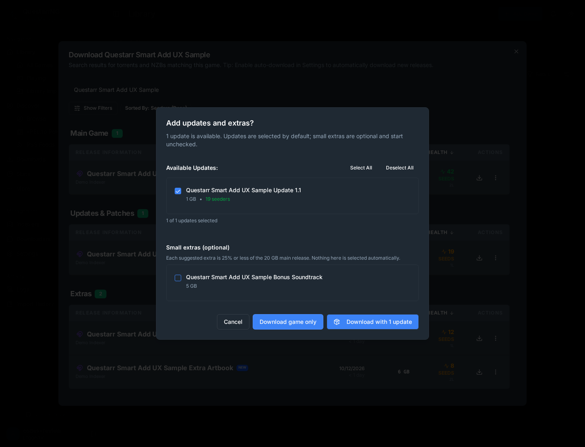
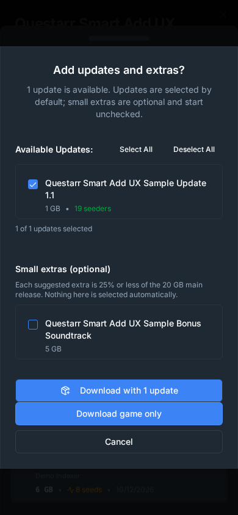

# Choosing a release, updates, and extras

Questarr can group related downloads when you select a main game release. The
choice is shown before Questarr sends releases to a configured downloader or
starts a direct torrent-file download.

## Updates

When search results include update releases, Questarr opens a bundle picker.
Updates start selected because they are the most likely companion content a
player expects with the main game. Review the release titles and sizes, clear
any update you do not want, or use **Select All** and **Deselect All**. The
dialog shows how many updates are selected.

## Optional extras

Extras are suggestions only when both the main release and an extra have a
known, positive size, and the extra is no larger than 25% of the main release.
Suggested extras are unchecked by default. Larger extras, zero-size results,
and results without a usable size are omitted from the suggestion list. This
keeps optional downloads under the user's control and avoids treating a
missing size as evidence that an extra is small.

The 25% cutoff is a clear, conservative interpretation of “a lot smaller” in
[upstream issue #205](https://github.com/Doezer/Questarr/issues/205). It is a
size heuristic, not a compatibility guarantee: compare the release name and
source before opting into an extra.

## Download choices

- **Download with updates/extras** sends the main release and the selected
  companion releases.
- **Download game only** sends just the main release, even when updates are
  listed or selected.
- Selecting **Download** for a main result and starting a direct torrent-file
  download both show the companion-content choice when applicable.
- If no qualifying extras have a known size, Questarr does not show an extras
  suggestion. If update results exist, the update choice still appears.

Selection is per download. Questarr does not automatically choose extras or
remember a previous bundle choice for the next release.

## Why updates and extras behave differently

The issue asks Questarr to suggest updates and describes extras as lower
priority. Updates therefore start selected but remain editable. Extras remain
optional and unchecked so a suggestion cannot silently add a potentially
unwanted download. Showing sizes and preserving a main-game-only action makes
the tradeoff visible before anything is sent to a downloader.

## Screenshots

The desktop and mobile captures show the update and extra choices in the running
application:

