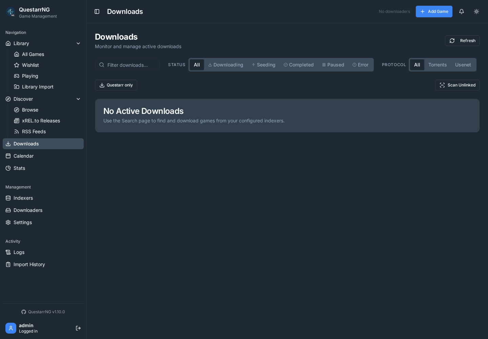

# Upstream resolution campaign

## Objective and scope

Audit every issue and PR in Doezer/Questarr, including closed issues, merged PRs,
and closed unmerged PRs. Implement still-unresolved actionable requests in
QuestarrNG, preserving existing fork integrations. The user confirmed full
historical scope on October 12, 2026.

The target is demonstrable resolution of each underlying request. Upstream
maintainers retain control over acceptance, merging and administrative closure.
Duplicates, obsolete dependency bumps, conflicting proposals, support questions
and repository governance changes require an explicit disposition and evidence;
they are not instructions to blindly replay every historical patch.

## Inventory and status

- [Every issue and PR](inventory.md): generated navigation table.
- [Resolution ledger](ledger.json): per-item findings, acceptance checks,
  dependencies and evidence. Review status is independent of GitHub state.
- [Source snapshot](sources.json): exported issue bodies/discussion and PR bodies.
  PR reviews/diffs and complete issue timelines still require detailed collection.

Latest inventory (October 12, 2026): **232 issues** (4 open, 228 closed) and
**915 PRs** (2 open, 705 merged, 208 closed unmerged), for **1,147 items**.

Of the 705 merged PRs, 487 merge commits are ancestors of the fork snapshot,
none are ancestors of upstream/main without also being in the fork, and 218 are
absent from both main histories. The remaining 210 PRs are open or closed unmerged. Release
branches, squash/rebase merges, equivalent patches and reverts require further
inspection. None of these counts proves functionality.

The fork and fetched upstream/main diverge by 175 fork-only and 130 upstream-only
commits at the initial snapshot. Reconcile those changes before independently
reimplementing fixes already delivered upstream. Preserve the current validation
engine work and the fork's SeerrNG, Real-Debrid, deployment and security behavior.

## Implementation sequence

1. Establish a clean validation baseline and reconcile upstream/main in a dedicated
   branch. Group conflicts by subsystem and retain fork-specific behavior.
2. Review the six open items and all 208 closed unmerged PRs, including comments,
   review threads and diffs. Link duplicates and later replacements.
3. Review all 228 closed issues and 705 merged PRs against the resulting code.
   Convert each outstanding requirement into a reproducible acceptance check.
4. Implement dependency-ordered batches: correctness/security and data integrity;
   search and release selection; update management; metadata providers; federation;
   remaining product, deployment, accessibility and documentation gaps.
5. Validate each batch and then the combined system. Record exact source commits,
   command results, relevant migrations and running UI evidence.
6. Refresh the upstream snapshot, review changes since collection, and produce a
   per-item completion report and upstream-ready change descriptions.

Do not mark an item resolved solely because a related commit exists, its PR was
merged, a UI control was added, or a unit test passed. Verify the requested user
journey, persistence, authorization and failure behavior where relevant. Database
changes cover SQLite and PostgreSQL. UI PRs require screenshots/recordings of
`npm run dev:test` in the PR description, as required by AGENTS.md.

## Initial open-item findings

| Item                                                                            | Required investigation / proposed treatment                                                                                                                                                                                                                           |
| ------------------------------------------------------------------------------- | --------------------------------------------------------------------------------------------------------------------------------------------------------------------------------------------------------------------------------------------------------------------- |
| [#923: update notification](https://github.com/Doezer/Questarr/issues/923)      | Maintainer comments say bell/Apprise notifications already exist and update management is in progress. Verify the actual fork behavior and thumbnail indication without duplicating notification machinery.                                                           |
| [#906: cross-server libraries](https://github.com/Doezer/Questarr/issues/906)   | This is a protocol proposal, not a completed specification for Questarr. Inspect the referenced protocol and closed PR #1083. Define identity, peer revocation, separate browse/download grants, local file boundaries and compatibility tests before implementation. |
| [#406: file-type search](https://github.com/Doezer/Questarr/issues/406)         | Verified torrent-manifest extension filtering with safe redirect handling; magnets, Usenet and unknown payloads fail closed rather than relying on release-title text.                                                                                                |
| [#336: alternative game sources](https://github.com/Doezer/Questarr/issues/336) | Verified optional Hydra-format public HTTPS catalogs, bounded schema and torrent-link checks, source attribution, and integration with aggregated search; curated catalog origin is not proof of malware safety.                                                      |
| [#1172: v1.5 release preparation](https://github.com/Doezer/Questarr/pull/1172) | Verified the applicable docs and browser coverage in QuestarrNG; preserve its 1.10.0 release identity and secure HTTP opt-in defaults. Upstream tagging and publication remain Doezer release operations.                                                             |
| [#1166: release scoring engine](https://github.com/Doezer/Questarr/pull/1166)   | Engine-only PR with substantial review follow-ups. Review latest head, title utility prerequisites and regex dependency. Link closed #1103 and issue #1090; full release-scoring feature may require persistence, search integration and UI beyond this PR.           |
| [#1131: RAWG metadata](https://github.com/Doezer/Questarr/pull/1131)            | The maintainer requested RAWG as an optional alternative, not an IGDB replacement. QuestarrNG implements that direction with separate IDs and passing stubbed-provider tests; a live RAWG API response still needs an operator key.                                   |

These findings were preliminary; the follow-up sections record completed implementation and final dispositions.

## First implementation batch

Issue [#1169](https://github.com/Doezer/Questarr/issues/1169) and PR
[#1170](https://github.com/Doezer/Questarr/pull/1170): ported the SABnzbd category
fallback and five upstream regression cases from Vincent A's commit
`58d984d2cda90f1b04fffb5deffb15527dbeeec5`. Requests now select the explicit
category, then the saved downloader category, then `games`.

The two configured-category cases failed before the fix; all 19 tests in the
two SABnzbd suites pass afterward. TypeScript checking and changed-production-file
lint pass. [Before](evidence/sabnzbd-before.txt) and
[after](evidence/sabnzbd-after.txt) results are retained.

The reporter subsequently said the upstream fix still did not work on a dev
image. We reproduced the full path through Questarr's authenticated downloader
API and SABnzbd 5.1.3: the configured category survived save and reload, Test
Connection succeeded, a request without its own category entered the saved
category, and an explicit request category overrode it. With no configured
category, the adapter uses `games`. SABnzbd maps unregistered category names to
`*` (Default), so the compatibility guide now calls out that the category must
also exist in SABnzbd. Both entries are now `verified`; the test queue was
cleared and no Usenet server was configured, so no content was downloaded.
See [batch 6](evidence/validation-batch-6.txt).

## Refresh and review workflow

Run from this checkout, using the repository's RTK wrapper when installed:

```sh
rtk git fetch upstream
rtk node scripts/audit-upstream.mjs
```

An optional directory argument imports `questarr-upstream-issues.json` and
`questarr-upstream-prs.json` produced by equivalent `gh ... list --json` exports.
The tool preserves per-item reviews, records source digests and flags changed
sources. It does not silently promote items to resolved. For a final review,
fetch all paginated issue comments/timeline events and PR discussions/review
threads, plus relevant diffs, then record evidence in the ledger.

Suggested review states: `unreviewed`, `investigating`, `needs-implementation`,
`implemented-unverified`, `verified`, `duplicate`, `superseded`,
`decision-required`, `not-applicable`. Terminal dispositions need a rationale
and links to the replacement or supporting evidence.

## Working location

The campaign starts in the isolated `codex/upstream-resolution` branch and
`QuestarrNG-upstream-resolution` sibling worktree. The original
`codex/validation-live-progress` checkout remains available for its existing work.

## Initial integration checkpoint — October 12, 2026

Upstream main through `fb650bab` is merged with fork behavior preserved. This
includes import/library discovery, backlog roulette, download recovery, archive
update handling and Prowlarr changes. The unsafe blanket HTTP-consent backfill is
excluded: revoked consent stays revoked.

Later batches delivered thumbnail update badges (#923), Hydra-format JSON
catalogs (#336), strict torrent-manifest extension filtering (#406), the standalone
release scoring engine (#1166), and Prowlarr release-preparation fixes/coverage (#1172).
The scoring source comes from upstream head `9998f5a9`; its Jessomadic/Questarr
GPL attribution remains in the source. Release-preparation ports come from
`07d7386b`.

Initial validation: 3,997 tests passed, seven skipped; statements 84.62%, branches 77.44%,
functions 82.02%, lines 86.02%. TypeScript, lint, secret scanning and production
build pass. See [checkpoint evidence](evidence/validation-batch-1.txt).
Running UI screenshots are in `docs/pr-evidence/upstream-*.png`.

This is a checkpoint, **not completion of all 1,147 items**. Optional RAWG support
and issue #1081's per-user Socket.IO delivery are now implemented; federation,
integrated scoring profiles, real-service checks and most historical per-item
reviews remain. The ledger distinguishes verified behavior from integration work
still awaiting real external services. No upstream issue or PR has been closed.

## Follow-up: optional RAWG provider

RAWG is now available as an optional, additive metadata and discovery provider
from **Settings → Integrations**. It stores a separate provider ID, encrypts the
API key, keeps IGDB active for SeerrNG, applies per-user content filters and
provides attribution only when RAWG is configured. See [RAWG setup and terms](../RAWG.md).
Upstream PR #1131 remains open; its maintainer explicitly asked for this optional
provider behavior. The browser journey passes with stubbed RAWG results, but a
live response remains unverified until a valid API key is available.

Issue #906 is recorded as `not-applicable`: its author explicitly states the
federation specification is an offer, not a feature request. Closed PR #1103 is
now verified: release profiles persist, manual searches explain and sort scored
results, and opt-in automatic search admits only accepted releases. PR #1083 is
`not-applicable` because it only records the same protocol offer in contributor
documentation. Issue #406 is also verified: search checks the actual torrent
manifest and follows SSRF-checked redirects; unknown, magnet and Usenet results
are excluded with the limitation shown in the running UI. Issue #336 is verified:
operators can configure Hydra-format public HTTPS catalogs, and their torrent
links join normal aggregated search with source attribution. Catalog origin does
not certify release safety; the existing scanning controls remain applicable.
At that checkpoint, the ledger had 1,037 unreviewed records. Each of the four open issues
and four open PRs has a preliminary disposition; review status is tracked
separately from GitHub state. Issue #37 still needs the remaining mutation
routes moved to shared Zod validation.

## Follow-up: v1.5.0 release-preparation coverage (#1172)

The latest PR head is 9a4fd4d8. QuestarrNG now has quick-start, indexer/Prowlarr,
notification and RSS guides, a 33-page Mintlify navigation map, and a more
detailed Import guide covering archive updates, Wii U, recovery, ClamAV review,
disc images and Sort Extras. Twenty-six browser journeys for roulette, Discover,
settings organization and post-RC1 behavior pass, along with 60 focused
Prowlarr/SSRF unit tests. Version-specific 1.5.0 metadata is not copied over the
fork's current 1.10.0 identity. Existing HTTP integrations remain opted out
unless an operator explicitly grants that permission. Doezer retains control of
the upstream merge, tag and release publication.

## Follow-up: dependency and CI security fixes (#1186)

The fork already had PyJWT 2.15.1, a `fast-copy` 4.1.0+ override, no Tailwind
Typography or selector-parser dependency, and a single `engine.io` override.
QuestarrNG now pins Semgrep 1.180.0 in its hash-locked CI toolchain and records
that fork-specific update under v1.10.0. A clean hash-checked install passed,
`uv pip check` passed, the npm audit reported zero vulnerabilities, and the
configured SAST scan covered 928 tracked files with zero ERROR-severity
findings. The scan produced one WARNING on a route that checks both lexical and
real-path containment. This disposition resolves the applicable request while
leaving Doezer's PR open for its maintainer.

## Follow-up: per-user Socket.IO events

Issue [#1081](https://github.com/Doezer/Questarr/issues/1081) is verified. Every
private `notifyUser` event is routed to the authenticated owner's socket room,
including download status, library scan progress, game refreshes and import task
updates. Events without a known owner are dropped. Socket tests cover delivery
between two users and unknown-owner suppression; the full unit suite passes.

## Follow-up: early API, download and startup requests (#1–25, #237/#245/#260)

The shared download-status contract now lives in `shared/schema.ts`. Database
environment settings are validated through Zod with an explicit Postgres opt-in,
and indexer/downloader PATCH bodies pass through shared Zod schemas before
reaching storage. QuestarrNG's Copilot instructions now describe the current
React 19/Vite 8/Express 5 stack and the dual-database layout. Existing discovery
download actions, qBittorrent support, download details/history, indexer
categories/testing, carousel controls, and first-user setup/login were checked
against their original requests.

The production image was rebuilt and smoke-tested: `nanoid` resolved at runtime,
both migration journals were packaged, first-start migrations completed, and
the health and protected SeerrNG routes returned their expected responses. Issue
#260 is `not-applicable`: the report showed a Compose hostname/internal-port
mismatch, and the reporter confirmed that a clean pull fixed it.

At that checkpoint, the ledger had 1,105 unreviewed items, 38 verified, 3
`not-applicable`, and one implemented-but-unverified integration. The full suite
passed with 4,016 tests and 7 skips; typecheck, lint, format, production build,
and PostgreSQL schema checks also passed. The downloads-page screenshot was
captured after its loading state settled and is included in the review evidence:



## Follow-up: early search and product requests (#26–60, PRs #61–69)

Multi-indexer search, background notifications, library statistics, settings,
health/readiness probes, downloader fallback and rTorrent support, indexer
controls, download details/errors, authentication, and structured error handling
are present in the fork and documented per item in the ledger. The health
request uses separate liveness and readiness routes so public probes do not
reveal component-specific details.

IGDB search now retries transient 429 and 5xx responses for at most three
requests, honors bounded `Retry-After` delays, and reduces routine search logs to
debug level. The PostCSS `from` setting from PR #101 is restored in Vite; the
production build has no PostCSS warning. Issue #37 remains open in the ledger:
validation is not yet uniformly Zod-based across every POST/PATCH body.

This batch passed the full suite with 4,019 tests and 7 skips, plus typecheck,
lint, and production build. See [batch 10 evidence](evidence/validation-batch-10.txt).
The ledger now has 1,062 unreviewed items, 80 verified, 3 `not-applicable`, one
implemented-but-unverified integration, and one item still needing implementation.

## Follow-up: cleanup, dependency, and deployment requests (#70–95)

The next slice covers Replit cleanup, dependency upgrades, the indexer sidebar,
downloader fallback and rTorrent support, rate limiting, indexer test UI,
discovery downloads, and on-demand image publishing. Current package and action
versions supersede the historical dependency PRs. Dependabot now requests only
labels available in this fork, and the README documents the manual image
workflow and where runtime credentials belong. Review feedback was checked
against current source, including replies on several threads that remain marked
unresolved upstream.

This batch passed formatting and YAML parsing checks. No application code changed;
the latest full run remains 4,019 tests passed and 7 skipped. The ledger now has
1,037 unreviewed items, 105 verified, 3 `not-applicable`, one
implemented-but-unverified integration, and one item still needing
implementation. See
[batch 11 evidence](evidence/validation-batch-11.txt).

Public source snapshots redact database connection strings found in support
reports; the collection script applies the same redaction on refresh.

## Follow-up: settings, multi-select, runtime, and dependency requests (#96–111)

PR #96 asked to restore `drizzle-zod` 0.7 after the 0.8.3 type migration failed;
the maintainer then requested a migration instead of a revert. Merged PR #110
now supplies that migration, so #96 is recorded as superseded. The read-only
settings API is protected by the default-deny authentication boundary and omits
the IGDB client ID. Client-only game fields are filtered before API submission,
example directories are excluded from typechecking, and health/readiness probes
remain available. Dependency PRs #104–108 are satisfied by newer locked package
versions and pinned checkout actions.

The Torznab category multi-select request (#102) was already implemented, but
reviewing its accessibility behavior exposed nested buttons: each category's
remove button lived inside the popover trigger button. The trigger now reports
the selection count and removable category badges sit outside it. A component
test verifies removal does not open the trigger, and the running indexer dialog
was checked in a browser. The [multi-select screenshot](../pr-evidence/upstream-torznab-multiselect.png)
is ready to attach to the eventual upstream PR description.

Issue #109 and PR #111 cover Replit cleanup and working development/production
builds. No Replit runtime artifacts remain. Development mode was exercised via
`npm run dev:test`; the production build and server start passed, and the
`/api/health`, `/login`, and nested `/activity/imports` routes returned HTTP 200. PR #103's downloader error response and notifications were verified in the
current route and client consumers. PR #101's PostCSS fix and PR #110's
`drizzle-zod` migration also pass the current build and typecheck.
The three records flagged by source digest (#237, #245, and #260) were also
rechecked. #237's last comment uses `localhost` for PostgreSQL inside the app
container, a hostname configuration issue also explained in #260; its original
nanoid and first-start migration problems are fixed.

Batch 12 passed the full suite (**4,020 passed, 7 skipped**), typecheck, lint,
format check, and production build. The browser test used a stubbed category
response; it did not contact a live indexer. The ledger now has **120 verified**,
**1 superseded**, **1,021 unreviewed**, **3 not-applicable**, **1
implemented-but-unverified**, and **1 needs-implementation** record. Issue #37
still needs shared Zod validation across every POST/PATCH route. See
[batch 12 evidence](evidence/validation-batch-12.txt).

## Follow-up: discovery, logging, downloads, and downloader requests (#112–125)

All fourteen PRs in this range were reviewed against their descriptions and
available discussion/review feedback. The nominal workflow and discovery
carousel requests are already supported; aggregated indexer search, typed Zod
configuration, bounded IGDB search, qBittorrent/rTorrent support, downloader
priority explanations, and download detail views are present. The abandoned
minimal qBittorrent PR #123 is superseded by #119. Dependency PRs #124–125 are
satisfied by newer locked versions.

Review found two implementation gaps. Several logging paths covered by PR #114
still used `console`, and unsafe bundle URLs were written into the warning; all
now use structured Pino logging without echoing the URL. PR #121's requested
unique genre, platform, and wishlist counts were missing from the current Stats
page; those cards are now present and tested. PR #122's rTorrent tracker query
requested five fields but interpreted ten, which made tracker state/error
reporting inaccurate. The matching XML-RPC fields are now requested and mapped,
with a fallback for older servers. The [running Stats page screenshot](../pr-evidence/upstream-global-library-stats.png)
is ready to include in the eventual upstream PR description.

Batch 13 passed the full suite (**4,022 passed, 7 skipped**), typecheck, lint,
format check, and production build. The Stats page was opened through
`npm run dev:test` in a headless browser; game/config responses were stubbed for
repeatable screenshot data. The refreshed upstream snapshot still contains
1,147 items. The ledger now has **133 verified**, **2 superseded**, **1,007
unreviewed**, **3 not-applicable**, **1 implemented-but-unverified**, and **1
needs-implementation** record. Issue #37 remains the outstanding implementation
item. See [batch 13 evidence](evidence/validation-batch-13.txt).

## Follow-up: dependencies, accessibility, and download feedback (#126–140)

All fifteen items in this range were reviewed against their PR descriptions,
changed files, discussion, and review records. The PRs have no submitted code
reviews. PR #128 says its dependency was already current; Dependabot closed
#134 and #139 because those grouped packages were updatable another way. Their
requested versions are now met or exceeded in the manifest and lockfile. Issue
#129 has no description and only a one-word comment, so it does not specify a
product change. Closed PR #138 asked for the same search tooltip later merged
with an accessible label in PR #140.

The memoization requests (#130, #132, #135, and #137) are present in the current
GameCard, library callback, DiscoverPage callbacks, and carousel section. The
historical SearchBar from #131 has since been replaced by PageToolbar and the
library filters, whose search, clear, filter-toggle, and remove-filter controls
have accessible names.

Two gaps needed code changes. PR #133's download dialog only disabled the
selected release button and showed no visible progress text. It now shows a
spinner and “Downloading...” on the active result, announces the state, and
disables all other direct-download buttons until the request settles. PR #136's
label had been attached to a generic clickable card. The game title is now a
real keyboard-focusable details button. Browser verification also exposed
portal clicks reopening the details dialog over the download dialog; the card
now ignores clicks from nested controls and its React portals. The screenshots
of both running states are ready for the eventual upstream PR description:
[download progress](../pr-evidence/upstream-download-pending-feedback.png) and
[keyboard-accessible details](../pr-evidence/upstream-view-details-accessible.png).

Batch 14 passed the full suite (**4,025 passed, 7 skipped**), typecheck, lint,
format check, and production build. `npm run dev:test` was exercised with
stubbed catalog, search, indexer, downloader, and in-flight download responses;
no real indexer or downloader was contacted. The refreshed inventory still has
1,147 items (705 merged PRs, 208 closed unmerged PRs, and 2 open PRs). PRs #1172
and #1186 merged during the refresh; their final source states were rechecked
and remain satisfied by the fork's release behavior and security fixes. The
ledger now has **146 verified**, **3 superseded**, **992
unreviewed**, **4 not-applicable**, **1 implemented-but-unverified**, and **1
needs-implementation** record. Issue #37 remains the outstanding
implementation item. See [batch 14 evidence](evidence/validation-batch-14.txt).

## Upstream main reconciliation — October 12, 2026

Upstream main through `ad69b8ca` is reconciled into the resolution branch. The
integration retains QuestarrNG's 1.10.0 version, image and repository identity,
security hardening, and SeerrNG/Real-Debrid behavior. Upstream's release guide,
browser evidence, and real-stack coverage were incorporated; the library-import
guide is now in the fork's documentation navigation.

The upstream migration `0044_backfill_insecure_lan` was excluded. QuestarrNG
already uses migration number 0044 for game and library fields, and backfilling
every existing HTTP connection to enabled would regrant permission even when a
user had explicitly revoked it. The real-stack upgrade fixture now begins after
the HTTP opt-in fields are introduced and verifies that both HTTP and HTTPS
permissions stay disabled through the remaining fork migrations.

Validation: 4,025 tests passed and seven skipped; typecheck, lint, formatting,
and production build passed. The real migration runner applied migrations 0035
through 0050 to the persisted fixture, and all four seeded permission values
remained `false`. `npm run test:stack` could not start locally because
`qbittorrent-nox` is not installed; the updated CI stack workflow installs the
required download clients. See
[reconciliation evidence](evidence/validation-upstream-main-reconcile.txt).

## Follow-up: carousel performance and accessibility (#141–147)

Discover now memoizes each carousel's query key by its own filters. Stable
mutation callbacks keep unrelated sections from rerendering when a genre or
platform changes. A regression test confirms that changing the genre leaves the
Popular Games key and callbacks untouched. PR #142's Dashboard handlers are
superseded by the fork's separate-page layout and PageToolbar.

Carousel refreshes keep their spinner and dimmed stale results, announce
“Updating [section]…” to assistive technology, and make the stale carousel
inert while it is hidden. A headless browser drove the running app through a
delayed refresh; the screenshot shows the live state:
[carousel refresh](../pr-evidence/upstream-carousel-refresh-accessibility.png).
GameCard cover images already load lazily, `/api/config` omits database
connection details, and Discover genre/platform filters already debounce by
300 ms.

The full suite passed with **4,027 tests and 7 skips**. The focused carousel
tests also passed after the final accessibility markup change. TypeScript,
lint, format check, and production build passed; Vite still reports its existing
large-chunk advisory. Upstream inventory remains at 1,147 records with no
source changes since review. The ledger now has **152 verified**, **4
superseded**, **985 unreviewed**, **4 not-applicable**, **1
implemented-but-unverified**, and **1 needs-implementation** record. Issue #37
remains the outstanding implementation item. See
[batch 15 evidence](evidence/validation-batch-15.txt).

## Follow-up: Discover title sync and upstream PRs #148–154

Genre and platform carousel headings now follow the same debounced values as
their query keys. During the debounce the old title stays with the old results;
once the new query begins, its heading appears with the matching cache or
loading skeleton. A headless browser captured the running transition:
[filter title sync](../pr-evidence/upstream-discover-filter-title-sync.png).

The rest of this PR group is covered by the existing opacity transition,
conditional lazy modal mounting in GameCard, the hardened `/api/config`
response, PageToolbar's labeled search and clear action, and the shared
`useDebounce` hook. The refreshed ledger now records **159 verified**, **4
superseded**, **978 unreviewed**, **4 not-applicable**, **1
implemented-but-unverified**, and **1 needs-implementation** record. Issue #37
remains the outstanding implementation item. See
[batch 16 evidence](evidence/validation-batch-16.txt).

## Follow-up: config, search, health, cache, and tooltip PRs #155–161

Settings no longer shows database connection state or a connection URL, and its
initial load has explicit success and error outcomes. Search already uses the
shared 500 ms debounce hook. The health endpoints expose only a generic status,
and the IGDB client reuses successful responses within their TTL. The separate
Dashboard refactor in #156 has no target in QuestarrNG's current page layout;
#158 was closed unmerged after newer dependency updates became available, and
the fork's current package versions are newer than that PR's requests.

GameCard's rating and release-date tooltips were present but skipped by keyboard
focus. Their triggers are now focusable with a visible focus ring. A keyboard
interaction in the running app captured the tooltip:
[GameCard metadata tooltip](../pr-evidence/upstream-gamecard-metadata-tooltips.png).

All 4,030 tests passed, with 7 skipped; typecheck, lint, format check, and the
production build passed. Vite continues to report its existing large-chunk
advisory. The ledger now records **164 verified**, **6 superseded**, **971
unreviewed**, **4 not-applicable**, **1 implemented-but-unverified**, and **1
needs-implementation** record. Issue #37 remains the outstanding
implementation item. See [batch 17 evidence](evidence/validation-batch-17.txt).

## Follow-up: upstream PRs #162–168

Health checks now have regression coverage for generic liveness/readiness
responses and readiness failures. The fork already has the compatible Zod 4
dependency pair and inferred insert types, Tailwind 4 sidebar rail selectors,
and accessible labels on the header controls. Added tests also lock in
whitespace-insensitive IGDB cache hits, the carousel empty state, and traversal
rejection for downloader and torrent paths.

All 4,034 tests passed, with 7 skipped; typecheck, lint, format check, and the
production build passed. Vite continues to report its existing large-chunk
advisory. The refreshed ledger records **171 verified**, **6 superseded**,
**964 unreviewed**, **4 not-applicable**, **1 implemented-but-unverified**, and
**1 needs-implementation** record. Issue #37 remains the outstanding
implementation item. See [batch 18 evidence](evidence/validation-batch-18.txt).

## Follow-up: upstream PRs #169–175

Genre and platform query conditions now have regression coverage for
order-independent cache keys. Discover already shows loading spinners in both
filter dropdowns, and the carousel navigation tooltips now have direct test
coverage. IGDB game searches cache processed results by query, limit, and local
filters: successful results last 15 minutes and empty results last 5 minutes.

Per-download path overrides must be relative and cannot contain parent
segments, with the same guard in the API validator and the Transmission and
rTorrent clients. Configured downloader roots remain allowed to be absolute.
The Search dialog now tells users to enter a relative path or leave the field
blank to use the configured default. The live dialog was captured here:
[download path guidance](../pr-evidence/upstream-relative-download-path-guidance.png).

PR #171 was closed as a duplicate of the earlier path-traversal work. The
other PRs in this group have no submitted code reviews or actionable comments;
their requested behavior is present in the fork or covered by this batch.
All 4,050 tests passed, with 7 skipped. Typecheck, lint, format check, and the
production build passed; Vite continues to report its existing large-chunk
advisory. The ledger now records **178 verified**, **6 superseded**, **957
unreviewed**, **4 not-applicable**, **1 implemented-but-unverified**, and **1
needs-implementation** record. Issue #37 remains outstanding. See
[batch 19 evidence](evidence/validation-batch-19.txt).

## Follow-up: upstream PRs #176–182

No application changes were needed for this group. The disabled-carousel
navigation tooltip (#176), IGDB search-result cache (#178), sidebar-trigger
tooltip (#179), and background refresh feedback in the Library grid (#182) are
already present and covered by tests. The traversal proposals (#177 and #181)
are duplicates of the protections recorded in batch 19; #177 has no file diff,
and the maintainer explicitly called #181 a duplicate. The old development
dependency group bump (#180) was closed as no longer needed, and the fork
already declares newer versions.

Focused tests passed: 3 carousel tests and 5 GameGrid tests. There were no
additional actionable review comments; the remaining comments were generic
Jules greetings. The ledger now records **182 verified**, **9 superseded**,
**950 unreviewed**, **4 not-applicable**, **1 implemented-but-unverified**, and
**1 needs-implementation** record. Issue #37 remains outstanding. See
[batch 20 evidence](evidence/validation-batch-20.txt).

## Follow-up: upstream PRs #183–187 and issues #188–189

PR #183's extra carousel-title state is not present in the fork: the title is a
prop and `GameCarouselSection` is memoized. PR #184's SSRF concern is covered by
the shared `safeFetch` layer, which validates all resolved addresses, pins the
connection to the validated address, and revalidates redirects. The fork keeps
private LAN downloader hosts available for self-hosted installations while
blocking metadata, link-local, and unspecified targets. PR #185's Download
icon already has a tooltip; View Details is a visible text button. PR #186's
search notifications remember the last query in a ref, so that bookkeeping
adds no state update. PR #187 duplicates the path protections reviewed in
batch 19.

Issue #188 is covered by the routed Library page and live Library, Wishlist,
and Downloads badges. For #189, Calendar and Wishlist moved under a collapsed
“More” group; those routes remain accessible, and the group opens when either
route is active. Trending is not a standalone page or navigation item in the
fork; trending mods are shown in game details. Live screenshots show the
collapsed and expanded navigation states:
[collapsed](../pr-evidence/upstream-low-priority-pages-collapsed.png) ·
[expanded](../pr-evidence/upstream-low-priority-pages-expanded.png).

Focused validation passed: 15 test files and 244 tests, including sidebar,
carousel, GameCard, search notifications, downloader SSRF, and downloader
client coverage. Typecheck, lint, formatting, and production build passed. Vite
continues to report its existing large-chunk advisory. The ledger now records
**188 verified**, **10 superseded**, **943 unreviewed**, **4 not-applicable**,
**1 implemented-but-unverified**, and **1 needs-implementation** record. Issue
#37 remains outstanding. See [batch 21 evidence](evidence/validation-batch-21.txt).

## Follow-up: downloader and query refinements (#190–196)

PR [#190](https://github.com/Doezer/Questarr/pull/190) is superseded by newer
versions of all nine proposed development dependencies already declared and
locked in QuestarrNG. Issue [#191](https://github.com/Doezer/Questarr/issues/191)
is verified: Prowlarr indexer sync, Torznab/Newznab mapping, diagnostics, saved
sync settings, and feed integration are present, with explicit consent required
for insecure LAN HTTP. PR [#192](https://github.com/Doezer/Questarr/pull/192) is
not applicable as written because TanStack Query v5 removed per-query `onError`
callbacks; Discover keeps its supported error handling. PR #193 duplicates the
verified GameCard tooltip work from PR #185, and PR #194 is covered by the
verified path-traversal protections from PRs #171, #174, #177, #181, and #187.

Issue [#195](https://github.com/Doezer/Questarr/issues/195) is verified: the
Downloads API filters each downloader’s results to its configured category,
case-insensitively, and excludes uncategorized entries while filtering. Issue
[#196](https://github.com/Doezer/Questarr/issues/196) is also verified: each
GameDownloadDialog result offers a Copy Torrent Link action, tested against the
actual result URL. Five focused suites passed (122 tests, one skipped); see
[batch 22 evidence](evidence/validation-batch-22.txt).

The ledger now records 192 verified, 12 superseded, 936 unreviewed,
5 not-applicable, 1 implemented-but-unverified, and 1 needs-implementation
records. Issue #37 remains outstanding.

## Follow-up: discovery, library, theme and smart-add items (#198–207)

Issues [#198](https://github.com/Doezer/Questarr/issues/198),
[#199](https://github.com/Doezer/Questarr/issues/199),
[#201](https://github.com/Doezer/Questarr/issues/201),
[#202](https://github.com/Doezer/Questarr/issues/202), and
[#203](https://github.com/Doezer/Questarr/issues/203) are verified against the
current app. Discover hides are persisted; the final #199 commits explicitly
choose Adventure despite the stale Action title; GameCards have no Launch
control; the root Library has working filters; and the theme toggle changes the
page styling. The workflow-permissions commit later linked to #203 does not
implement the theme behavior.

Issue [#205](https://github.com/Doezer/Questarr/issues/205) is implemented. When
the user picks a main release, the add-on dialog keeps updates selected by
default and offers extras up to 25% of the main release size as unchecked
suggestions. Larger extras and results with unknown sizes are left out. The
dialog shows item sizes, supports combining selected updates and extras, and
keeps a clear main-game-only action. The 25% cutoff is our conservative reading
of “a lot smaller,” chosen to make the suggestion predictable and transparent.

PR [#207](https://github.com/Doezer/Questarr/pull/207) is superseded: all nine
dependency updates in that PR are older than the versions declared and locked
in the fork.

Seven focused UI suites passed (76 tests, one skipped). TypeScript checking and
format checking passed. Headless-browser verification covered the theme class
and computed background change, and the smart-add flow was captured from
`npm run dev:test` with representative search results in
[desktop](../pr-evidence/upstream-smart-add.png) and
[mobile](../pr-evidence/upstream-smart-add-mobile.png) screenshots.
See [batch 23 validation](evidence/validation-batch-23.txt).

The ledger now records **198 verified**, **13 superseded**, **929 unreviewed**,
**5 not-applicable**, **1 implemented-unverified**, and **1 needs-implementation**.
Issue #37 remains outstanding.

## Follow-up: search, calendar, and download items (#208–225)

Issues [#208](https://github.com/Doezer/Questarr/issues/208) and [#209](https://github.com/Doezer/Questarr/issues/209) are verified: download results remain scrollable on desktop and mobile, and extended search supports the query and filtering controls requested. Issue [#210](https://github.com/Doezer/Questarr/issues/210) now has bug, feature, and question templates; #211 and #215 are covered by the existing README, license, contribution guide, and docs.

Issues [#212](https://github.com/Doezer/Questarr/issues/212), [#214](https://github.com/Doezer/Questarr/issues/214), and [#222](https://github.com/Doezer/Questarr/issues/222) are verified against the current calendar, wishlist, and details layouts. Issue [#213](https://github.com/Doezer/Questarr/issues/213) is superseded: upstream later removed the Trending page and its navigation. Issue [#216](https://github.com/Doezer/Questarr/issues/216) marks a game owned when its main download completes.

Issue [#217](https://github.com/Doezer/Questarr/issues/217) now has a visible direct torrent/NZB file action separate from adding a release to a downloader. The action is limited to safe file URLs, preserves the update-selection step, and release titles wrap cleanly on mobile. Running-app screenshots show the desktop result list, update choice, and mobile layout in [desktop](../pr-evidence/upstream-direct-download.png), [update-choice](../pr-evidence/upstream-direct-download-bundle.png), and [mobile](../pr-evidence/upstream-direct-download-mobile.png) views. Issue [#219](https://github.com/Doezer/Questarr/issues/219) recognizes IGDB’s explicit delayed status with date-shift fallback and notifications. Issues [#220](https://github.com/Doezer/Questarr/issues/220) and [#221](https://github.com/Doezer/Questarr/issues/221) are covered by header storage reporting and configurable scheduled searches.

PR [#223](https://github.com/Doezer/Questarr/pull/223) is superseded by the fork’s current npm tooling and existing dependency, mock, documentation, and template state. PRs [#224](https://github.com/Doezer/Questarr/pull/224) and [#225](https://github.com/Doezer/Questarr/pull/225) are verified: notification actions have accessible names, and metadata refresh batches IGDB requests and database writes.

The focused GameDownloadDialog suite passed (46 tests, 1 skipped); type checking, lint, and format checks passed. Headless-browser evidence was captured from `npm run dev:test`. See [batch 24 validation](evidence/validation-batch-24.txt).

The ledger now records **213 verified**, **15 superseded**, **912 unreviewed**, **5 not-applicable**, **1 implemented-unverified**, and **1 needs-implementation** records. Issue #37 remains outstanding.

## Follow-up: repository hardening, Usenet, and version tracking (#226–233)

PRs [#226](https://github.com/Doezer/Questarr/pull/226) and [#227](https://github.com/Doezer/Questarr/pull/227) are superseded by the current npm toolchain, passing checks, and existing contribution/operations guidance and PR template. The checked repository docs and local memory files contain no stale pnpm policy.

Issue [#228](https://github.com/Doezer/Questarr/issues/228) and merged PR [#233](https://github.com/Doezer/Questarr/pull/233) are verified: Prowlarr sync and Newznab search accept Usenet indexers, results retain NZB metadata, and only SABnzbd/NZBGet are used for Usenet downloads. Issue [#230](https://github.com/Doezer/Questarr/issues/230) is also verified. Installed versions can be entered directly or learned from completed game/edition releases; scheduled searches ignore versions already installed. Version and target-platform selection are scoped to each library entry.

Ten focused Usenet and version-tracking suites passed (285 tests). See [batch 25 validation](evidence/validation-batch-25.txt).

The ledger now records **216 verified**, **17 superseded**, **907 unreviewed**, **5 not-applicable**, **1 implemented-unverified**, and **1 needs-implementation** records. Issue #37 remains outstanding.

## Follow-up: startup, qBittorrent, search and accessibility (#239–244)

PR [#239](https://github.com/Doezer/Questarr/pull/239) is superseded by the fork’s current startup design: the app uses its own SQLite/PostgreSQL migration runners and existing structured logger, so production startup does not need to ship or invoke `drizzle-kit`. Issues [#240](https://github.com/Doezer/Questarr/issues/240) and [#241](https://github.com/Doezer/Questarr/issues/241) are verified: the container starts the compiled app, which applies migrations itself, and the logger import and production TypeScript build pass.

Issue [#242](https://github.com/Doezer/Questarr/issues/242) is verified against the qBittorrent VPN fix later delivered in [PR #276](https://github.com/Doezer/Questarr/pull/276). When qBittorrent cannot fetch an indexer URL through its VPN network, the client can fetch the torrent file and upload it to qBittorrent. If the add is accepted but the torrent cannot be confirmed yet, Questarr keeps its correlation tag and shows a “Checking qBittorrent” message that asks users to check the client before retrying. The free-space lookup also falls back to qBittorrent server-state data. A headless screenshot of the running pending-confirmation state is in [PR evidence](../pr-evidence/upstream-qbittorrent-pending.png).

PR [#243](https://github.com/Doezer/Questarr/pull/243) is verified: IGDB fallback searches run concurrently, with regexes compiled once and the five-request cap preserved. PR [#244](https://github.com/Doezer/Questarr/pull/244) is verified: notification rows are semantic buttons with native keyboard activation and an explicit button type.

Ten focused test suites passed (211 tests, one skipped). Type checking, lint, formatting, and the production Vite/TypeScript builds passed. See [batch 26 validation](evidence/validation-batch-26.txt).

The ledger now records **221 verified**, **18 superseded**, **901 unreviewed**, **5 not-applicable**, **1 implemented-unverified**, and **1 needs-implementation** records. Issue #37 remains outstanding.

## Follow-up: build, downloader concurrency, accessibility and operations (#246–251)

Issue [#246](https://github.com/Doezer/Questarr/issues/246) is verified. Its `cron.ts` type errors match the follow-up reported in #241 and are absent from the current production build. The reporter later confirmed that updating Node/npm fixed installation; the fork requires Node 22.19 or newer. The database connection error mentioned when closing #246 was the separate report tracked in #260.

PR [#247](https://github.com/Doezer/Questarr/pull/247) is verified: download and free-space lookups use parallel downloader requests, while per-client failures leave other results available. PR [#248](https://github.com/Doezer/Questarr/pull/248) is verified: Calendar navigation and Discover settings have descriptive accessible names, now checked through role-based page tests.

PR [#249](https://github.com/Doezer/Questarr/pull/249) is verified. The old type mismatch is fixed in the current code; the maintained contribution guide and PR template replace its generic templates, and [the operations guide](../OPERATIONS.md) now explains health checks, logs, and safe SQLite/Postgres backup and recovery. Its placeholder task list is replaced by this per-item ledger.

PR [#250](https://github.com/Doezer/Questarr/pull/250) is superseded: the workflows use the pinned step-security build/push action rather than the old upstream action. PR [#251](https://github.com/Doezer/Questarr/pull/251) is superseded by the pinned metadata-action v6.2.0, above the requested v5.10.0.

Four focused suites passed (386 tests), including the downloader routes and rendered accessibility names. TypeScript checking passed; the production build was also verified in [batch 26](evidence/validation-batch-26.txt). See [batch 27 validation](evidence/validation-batch-27.txt).

The ledger now records **225 verified**, **20 superseded**, **895 unreviewed**, **5 not-applicable**, **1 implemented-unverified**, and **1 needs-implementation** records. Issue #37 remains outstanding.

## Follow-up: dependency update PRs (#252–259)

All eight requests are superseded by versions already in the fork. Current
workflow pins use step-security registry-login and Buildx wrappers, and the
checkout SHA matches upstream v7.0.1. I corrected stale workflow comments that
called that SHA v6.2.0. The package manifest and lockfile exceed the requested
versions of react-hook-form, fast-xml-parser, TanStack Query, Drizzle ORM, and
Recharts. No older action or package-lock changes need to be replayed.

The manifest, lockfile, and workflow pins were checked directly; no application
code changed in this batch. See [batch 28 evidence](evidence/validation-batch-28.txt).

## Follow-up: database, Usenet, downloader setup and hardening (#261–266)

Issue [#261](https://github.com/Doezer/Questarr/issues/261) is verified: the
reporter confirmed a no-cache Compose rebuild reached the initial setup screen.
The current fork also has documented SQLite/Postgres startup configuration and
more actionable Postgres connection diagnostics.

Issue [#262](https://github.com/Doezer/Questarr/issues/262) is verified: the
reporter tested the fix and closed the report after NZB submission worked. The
current download validator accepts NZB URLs, search preserves the Usenet type,
and downloader selection sends those results to SABnzbd or NZBGet.

PR [#263](https://github.com/Doezer/Questarr/pull/263) is verified: downloader
forms use a consistent Host field with separate Port and TLS controls, defaults
that follow the selected client, and client-specific setup guidance. PR
[#264](https://github.com/Doezer/Questarr/pull/264) is verified through the
fork-adapted sidebar link and version check, which point at QuestarrNG and its
releases. PR [#265](https://github.com/Doezer/Questarr/pull/265) is verified:
route pages load lazily under a shared loading fallback, and the production
build emits distinct page chunks. PR
[#266](https://github.com/Doezer/Questarr/pull/266) is verified: Helmet applies
security headers with the app's tailored CSP, while the optional Postgres pool
has a configurable size, bounded connection/query waits, and idle-client error
handling.

Eight focused suites passed (461 tests), and TypeScript checking passed. A
production Vite build emitted separate route chunks; it also reports large
shared chunks (the entry chunk is about 865 KB), so the build confirms route
splitting without claiming a measured initial-load reduction. See
[batch 29 evidence](evidence/validation-batch-29.txt).

The ledger now records **231 verified**, **28 superseded**, **881 unreviewed**,
**5 not-applicable**, **1 implemented-unverified**, and **1 needs-implementation** records. Issue #37 remains outstanding.

## Follow-up: bundle security, indexers, accessibility and ROM support (#267–273)

PR [#267](https://github.com/Doezer/Questarr/pull/267) is verified with a
stronger bundle-specific SSRF boundary. The shared URL checker allows private
addresses for configured self-hosted integrations, so it was too permissive for
arbitrary bundle links. The ZIP endpoint now allows public downloads plus exact
configured indexer origins, and `safeFetch` checks every redirect under that
policy. The SSRF protections and LAN Prowlarr exception are covered by tests and
documented in the [threat model](../THREAT_MODEL.md) and
[security assessment](../SECURITY_ASSESSMENT.md).

PR [#268](https://github.com/Doezer/Questarr/pull/268) is verified: the
carousel refresh button has the accessible name “Refresh games,” now asserted
through its button role. Issue [#269](https://github.com/Doezer/Questarr/issues/269)
is verified: Discover downloads create or reuse the library game first, so the
request uses a UUID instead of a temporary `igdb-*` ID.

Issue [#270](https://github.com/Doezer/Questarr/issues/270) is verified: local
Prowlarr URLs pass indexer validation, category choices survive syncs, and
Newznab search applies the saved category filter. Issue
[#271](https://github.com/Doezer/Questarr/issues/271) is verified against the
fork's retro workflow: optional RAWG discovery, console-to-RomM platform
mappings, and reviewed ROM imports into RomM folders. PR
[#272](https://github.com/Doezer/Questarr/pull/272) is verified: bundle files
are fetched in parallel with a limit of five and individual failures do not
abort the ZIP. PR [#273](https://github.com/Doezer/Questarr/pull/273) is
superseded by the stricter #267 implementation: its duplicate `isSafeUrl`
check still inherited the self-hosted private-network allowance.

Twelve focused suites passed (322 tests, one skipped; 323 total), TypeScript checking and
server lint passed, and Prettier passed for the changed source files. The new
security release note validates. See [batch 30 evidence](evidence/validation-batch-30.txt).

The ledger now records **237 verified**, **29 superseded**, **874 unreviewed**,
**5 not-applicable**, **1 implemented-unverified**, and **1 needs-implementation** records. Issue #37 remains outstanding.

## Follow-up: storage caching, qBittorrent, and repository hardening (#274–279)

PR [#274](https://github.com/Doezer/Questarr/pull/274) is verified: the
storage endpoint fetches enabled downloaders concurrently and reuses its
in-memory result for 30 seconds. Individual downloader failures remain
isolated in the response. Issue
[#275](https://github.com/Doezer/Questarr/issues/275) is `not-applicable`:
the reporter later found that their Prowlarr configuration excluded `.rar`
results, then apologized for the false alarm; Questarr did not need a code
change.

PR [#276](https://github.com/Doezer/Questarr/pull/276) is verified against the
qBittorrent client and regression suites: it can fetch a torrent file itself
and upload it when qBittorrent is behind a VPN, exposes download details, and
maps current client status into the downloads view. PRs
[#277](https://github.com/Doezer/Questarr/pull/277) and
[#279](https://github.com/Doezer/Questarr/pull/279) are verified: action
buttons now default to `type="button"`, explicit form submits still work, and
the storage cache has a concrete TypeScript shape. The fork's
[operations guide](../OPERATIONS.md), contributor guide, and this per-item
ledger provide the operational and task-tracking guidance requested by the
closed PRs. Running-browser evidence for the form behavior is in
[PR evidence](../pr-evidence/upstream-button-form-safety.png).

Issue [#278](https://github.com/Doezer/Questarr/issues/278) is
`not-applicable`: the maintainer found no schema change in the reported v1.0.1
release, and the reporter confirmed that recreating their stale local database
volume restored login. The current Postgres baseline declares the user settings
columns used by the app; no reproducible migration defect was reported after
the volume reset.

The API-route and Button suites passed (372 tests), as did four focused
qBittorrent suites (61 tests). TypeScript, changed-file ESLint, Prettier, and
the production client build passed, as did the `npm run dev:test` browser
interaction. See [batch 31 evidence](evidence/validation-batch-31.txt).

The ledger now records **241 verified**, **29 superseded**, **868 unreviewed**,
**7 not-applicable**, **1 implemented-unverified**, and **1 needs-implementation**
records. Issue #37 remains outstanding.

## Follow-up: downloader/indexer behavior, Steam wishlist and hardening (#280–285)

PR [#280](https://github.com/Doezer/Questarr/pull/280) is verified: HTTP(S)
indexer URLs work for localhost and private/internal hosts, logger defaults
remain environment-appropriate, and downloader validation reflects the
integrations the fork actually supports. Regression tests retain Deluge support
while rejecting unsupported uTorrent and Vuze types. The fork also has the
link button variant from this PR.

PR [#281](https://github.com/Doezer/Questarr/pull/281) is verified: indexers
and downloaders sort enabled-first by priority and name, disabled cards are
visually muted, and the downloader name prompt follows the selected type. PR
[#282](https://github.com/Doezer/Questarr/pull/282) is verified: qBittorrent
free-space lookup falls back from `app/free_space` to `sync/maindata` and then
`transfer/info`, with invalid responses handled safely.

PR [#283](https://github.com/Doezer/Questarr/pull/283) is verified against the
fork’s GitHub-recognized contributor and PR guidance, maintained operations
guide, upstream ledger, and current type/lint/build checks; its generic version
bump was not applied to the fork. Issue
[#284](https://github.com/Doezer/Questarr/issues/284) is verified: users can
manually or automatically sync their Steam wishlist, and matched games enter
their QuestarrNG wishlist as wanted games. PR
[#285](https://github.com/Doezer/Questarr/pull/285) is verified: torrent and
Usenet search results retain and display their source indexer name, which also
drives filtering and priority ordering.

Twelve focused suites passed (290 tests, one skipped). TypeScript, lint,
Prettier, and the production client/server build passed. The production build
continues to report its existing large-chunk advisory. See
[batch 32 evidence](evidence/validation-batch-32.txt).

The ledger now records **247 verified**, **29 superseded**, **862 unreviewed**,
**7 not-applicable**, **1 implemented-unverified**, and **1 needs-implementation**
records. Issue #37 remains outstanding.

## Follow-up: container installs, xREL, settings recovery and download sources (#286–291)

Issue [#286](https://github.com/Doezer/Questarr/issues/286) is verified: the
default Compose file pulls the published multi-architecture GHCR image, and the
installation docs explain the stable, testing and pinned-version tags. Issue
[#287](https://github.com/Doezer/Questarr/issues/287) is verified against the
existing xREL API client, release page, settings and scheduled notifications.

Issue [#288](https://github.com/Doezer/Questarr/issues/288) is verified: the
Settings error now explains that migrations run at startup, gives the source
install command only where it applies, stops automatic retry loops, and offers
a **Try again** action. The running app showed the alert after one failed
settings request; the action recovered when the endpoint became available.
See [browser evidence](../pr-evidence/upstream-settings-db-migration-help.png).
PR [#289](https://github.com/Doezer/Questarr/pull/289) is verified: results
link to their source page when it is available, with unsafe URL schemes
excluded. PR [#290](https://github.com/Doezer/Questarr/pull/290) is verified:
the download dialog’s indexer filter now has a regression test that selects an
indexer and checks the matching results.

Issue [#291](https://github.com/Doezer/Questarr/issues/291) is verified: main
builds publish as `dev`, versioned releases publish as both `latest` and the
exact semantic version, and commit-SHA tags remain immutable. The default
Compose file pulls the registry image, while the README and quick start explain
how to update it. The linked release-pattern request #305 remains tracked for
its own per-item review. See [batch 33 evidence](evidence/validation-batch-33.txt).

Six focused suites passed (96 tests, one skipped). TypeScript, lint, Prettier,
the production client/server build, and Docker Compose validation passed. The
build retains its existing large-chunk advisory. The ledger now records
**253 verified**, **29 superseded**, **856 unreviewed**, **7 not-applicable**,
**1 implemented-unverified**, and **1 needs-implementation** records. Issue
#37 remains outstanding.

## Follow-up: hardening, G4U, download rules and release titles (#292–305)

PRs [#292](https://github.com/Doezer/Questarr/pull/292) and
[#295](https://github.com/Doezer/Questarr/pull/295) are verified against the
fork's stronger lint, type-safety, and operations baseline. Contributor and PR
templates, an operations guide, and this per-item ledger cover the requested
maintenance artifacts. Postgres uses a configurable bounded pool (default 10,
minimum 2), five-second connection and statement timeouts, and explicit pool
shutdown; this retains operator control instead of hardcoding a 20-connection
pool.

Issue [#293](https://github.com/Doezer/Questarr/issues/293) is verified: G4U
VIP API support is implemented, and multi-word game titles are converted to the
dot-separated query format G4U expects. Issue
[#294](https://github.com/Doezer/Questarr/issues/294) is verified: desktop
titles already use the available row width, and long titles now wrap fully on
mobile instead of being clipped. Safe source-page links are covered by PR #289.
See [mobile browser evidence](../pr-evidence/upstream-release-name-mobile-full.png).

Dependency PRs [#296](https://github.com/Doezer/Questarr/pull/296),
[#297](https://github.com/Doezer/Questarr/pull/297),
[#298](https://github.com/Doezer/Questarr/pull/298),
[#299](https://github.com/Doezer/Questarr/pull/299), and
[#302](https://github.com/Doezer/Questarr/pull/302) are verified against the
current lockfile, which contains each requested version or a later one. PR
[#300](https://github.com/Doezer/Questarr/pull/300) is superseded: its upstream
build check failed, maintainers described the update as breaking, and the bot
reported the dependency already up to date. This fork uses drizzle-zod 0.8.3
and passes its current checks, so the PR does not require a separate change.
PR [#301](https://github.com/Doezer/Questarr/pull/301)'s download rules are
implemented across settings, manual searches, and scheduled auto-search; a
regression test confirms the selected categories filter scheduled results. PR
[#303](https://github.com/Doezer/Questarr/pull/303)'s contributor list and
collapsible IGDB setup guide are already present in the README.

Issue [#304](https://github.com/Doezer/Questarr/issues/304) is verified: the
current Questarr Discord invite is linked in the README and documentation, and
the invite endpoint confirms it is active. Issue
[#305](https://github.com/Doezer/Questarr/issues/305) is verified with the tag
workflow from batch 33: main builds publish `dev`, while semantic-version
releases publish `latest`, the exact version, and an immutable commit tag.
See [batch 34 validation](evidence/validation-batch-34.txt).

Seven focused suites passed (579 tests, seven skipped). TypeScript, lint,
formatting, the production build, and Compose validation passed. The build
retains its existing large-chunk advisory. The ledger now records **266
verified**, **30 superseded**, **842 unreviewed**, **7 not-applicable**,
**1 implemented-unverified**, and **1 needs-implementation** records. Issue #37
remains outstanding.

## Follow-up: RomM, IGDB, downloads and hardening (#306–319)

PRs [#306](https://github.com/Doezer/Questarr/pull/306),
[#314](https://github.com/Doezer/Questarr/pull/314), and
[#319](https://github.com/Doezer/Questarr/pull/319) are verified against the
fork's lint, type-check, format, and build gates. The fork has contributor and
operations guidance; its source-bound CI build plan runs those checks. PR #306's
maintainer-requested removal of `TASKS.md` and `PR_TEMPLATE.md` is reflected in
the fork's checked-in artifacts.

PR [#307](https://github.com/Doezer/Questarr/pull/307) is verified: SQLite
migrations use a journal-aware idempotent runner with schema repair, while
Postgres uses Drizzle migrations under an advisory lock. PR
[#308](https://github.com/Doezer/Questarr/pull/308)'s search labels and
keyboard-accessible storage tooltip are present. PR
[#309](https://github.com/Doezer/Questarr/pull/309)'s bundle download validates
URLs and fetches through the SSRF-safe client, allowing only configured private
indexer origins. PRs [#310](https://github.com/Doezer/Questarr/pull/310) and
[#317](https://github.com/Doezer/Questarr/pull/317) are verified: IGDB ID
lookups batch requests in parallel within the configured rate limit, and the
regular request queue spaces other API calls.

Issue [#311](https://github.com/Doezer/Questarr/issues/311)'s ROM-management
request is implemented through RomM platform routing, library imports, and
post-processing. Removing a game with file deletion enabled now also permits
paths strictly inside that user's enabled RomM root, after canonical path
validation. A regression test confirms disabled RomM roots remain protected.
RAR extraction support is installed in the production image and covered by the
archive-import suite. SteamGridDB was mentioned as an optional artwork idea;
this fork continues to use its existing IGDB artwork integration. The linked
implementation PR [#363](https://github.com/Doezer/Questarr/pull/363) remains
scheduled for its separate ledger review. PR
[#312](https://github.com/Doezer/Questarr/pull/312)'s separator is present in
both download layouts. Issue
[#313](https://github.com/Doezer/Questarr/issues/313) is verified against
[#322](https://github.com/Doezer/Questarr/pull/322): qBittorrent detects magnet
redirects and reports actionable download errors.

PR [#315](https://github.com/Doezer/Questarr/pull/315) is verified: initial
setup accepts IGDB credentials when neither the database nor environment is
configured, and existing installations can manage credentials in Settings. PR
[#316](https://github.com/Doezer/Questarr/pull/316) is verified: auto-search
timestamps persist in user settings across restarts. PR
[#318](https://github.com/Doezer/Questarr/pull/318) is verified with a small
follow-up fix: selected categories now filter scheduled results, with DLC and
extras routed into the existing packs/add-ons availability channel. This also
closes the remaining scheduled-category gap shared with PR #301.

See [batch 35 validation](evidence/validation-batch-35.txt) and the release
notes for [RomM file removal](../../release-notes/2026-10-12-romm-library-file-deletion.md)
and [scheduled download categories](../../release-notes/2026-10-12-auto-search-selected-categories.md).

Fifteen backend suites passed (718 tests). The AddGameModal suite passed 15
tests separately, and GameDownloadDialog passed 49 tests (one skipped). The
ledger now records **280 verified**, **30 superseded**, **828 unreviewed**,
**7 not-applicable**, **1 implemented-unverified**, and **1
needs-implementation** records. Issue #37 remains outstanding.

## Batch 36 — October 12, 2026

Batch 36 reviewed [PRs #320–322 and #324, #326–327, #331–333](inventory.md)
and [issues #323, #325, #328–330](inventory.md). The manual-download flow
avoids automatic per-card searches while retaining cached availability. PR #321
is superseded by the sanitized merged #322; the existing qBittorrent redirect
fix also resolves issue #313. Setup, logout, dependency-update, and operational
hardening requests were verified against the current fork.

The current PostgreSQL-to-SQLite migration request (#329, related to PR #327)
now has a complete-schema copy tool. It requires both databases to have current
migrations, refuses a non-empty SQLite target, reads PostgreSQL read-only, and
verifies every copied table in a rollback-safe transaction. The legacy pre-v1.1
migration procedure remains separate. See the [migration guide](../DATABASE.md),
[release note](../../release-notes/2026-10-12-current-postgres-to-sqlite-migration.md),
and [batch 36 validation](evidence/validation-batch-36.txt).

The ledger now records **291 verified**, **33 superseded**, **814 unreviewed**,
**7 not-applicable**, **1 implemented-unverified**, and **1
needs-implementation** records. Issue #37 remains outstanding.

## Batch 37 — October 12, 2026

Batch 37 reviewed [PRs #334–335 and #337–347](inventory.md) and issue [#344](https://github.com/Doezer/Questarr/issues/344); issue #336 was reviewed in batch 5. The dependency requests are already exceeded by the locked versions. Metadata refresh uses 50-game transactions, and the merged IPv6 SSRF protections are present. Issue #344's reporter confirmed that the fresh-install problem cleared after the image was updated.

PR #338 is superseded by the later hardening iterations. PR #342's verification and risk-analysis prompts now live in GitHub's `.github/PULL_REQUEST_TEMPLATE.md`; PR #343's type, lint, and formatting work passes the current gates. The remaining fixed-delay setup test now waits for both field-validation messages. PR #345's shared empty state is now used in the Library, retaining its Add Game flow, providing a direct add action for a no-result search, and letting users clear filters from an empty filtered view. The IGDB rate-limit fallback also uses a module-specific structured logger. See the [release note](../../release-notes/2026-10-12-library-empty-states.md), [visual evidence](../pr-evidence/upstream-library-empty-state-batch-37.png), and [batch 37 validation](evidence/validation-batch-37.txt).

The ledger now records **303 verified**, **34 superseded**, **801 unreviewed**,
**7 not-applicable**, **1 implemented-unverified**, and **1
needs-implementation** records. Issue #37 remains outstanding.

## Batch 38 — October 12, 2026

Batch 38 reviewed [PRs #348–360](inventory.md) and issue [#361](https://github.com/Doezer/Questarr/issues/361). The four dependency updates are exceeded by the versions locked in this fork. The atomic setup and route typing, logout action, production security headers, Prowlarr sync hardening, keyboard focus behavior, RSS feeds, compact lists, and Apprise notifications are present. PR #354's requested 1.1.0 version bump is superseded by the current 1.10.0 release.

The xREL release integration is present and SSRF-hardened. Its game-filtered latest feed now scans until it finds an extra game result before enabling Next, instead of estimating from an unreliable upstream page count. The page shows the current page without a fabricated total. See the [release note](../../release-notes/2026-10-12-xrel-release-pagination.md), [visual evidence](../pr-evidence/upstream-xrel-pagination-batch-38.png), and [batch 38 validation](evidence/validation-batch-38.txt).

The ledger now records **316 verified**, **35 superseded**, **787 unreviewed**,
**7 not-applicable**, **1 implemented-unverified**, and **1
needs-implementation** records. Issue #37 remains outstanding.

## Batch 39 — October 12, 2026

Batch 39 reviewed [PRs #362–370 and #372–374](inventory.md) and [issues #371
and #375](inventory.md). The Steam wishlist workflow uses authenticated manual
SteamID64 linking; the upstream OAuth/session callback was not ported after its
review identified account-linking and secret-management risks. RomM imports,
root-folder scanning, the redesigned download dialog, GameCard labels, and
release-group filtering are present. Dependency targets are exceeded by the
current locked versions, and Prowlarr endpoints use the shared SSRF-safe fetcher.

Metadata refresh now streams IGDB data in bounded request batches while keeping
database writes at 50 games per transaction. A failed chunk is logged, later
chunks continue, and the response counts games that could not be refreshed. See
the [release note](../../release-notes/2026-10-12-metadata-refresh-chunk-resilience.md)
and [batch 39 validation](evidence/validation-batch-39.txt).

The ledger now records **330 verified**, **35 superseded**, **773 unreviewed**,
**7 not-applicable**, **1 implemented-unverified**, and **1
needs-implementation** records. Issue #37 remains outstanding.
