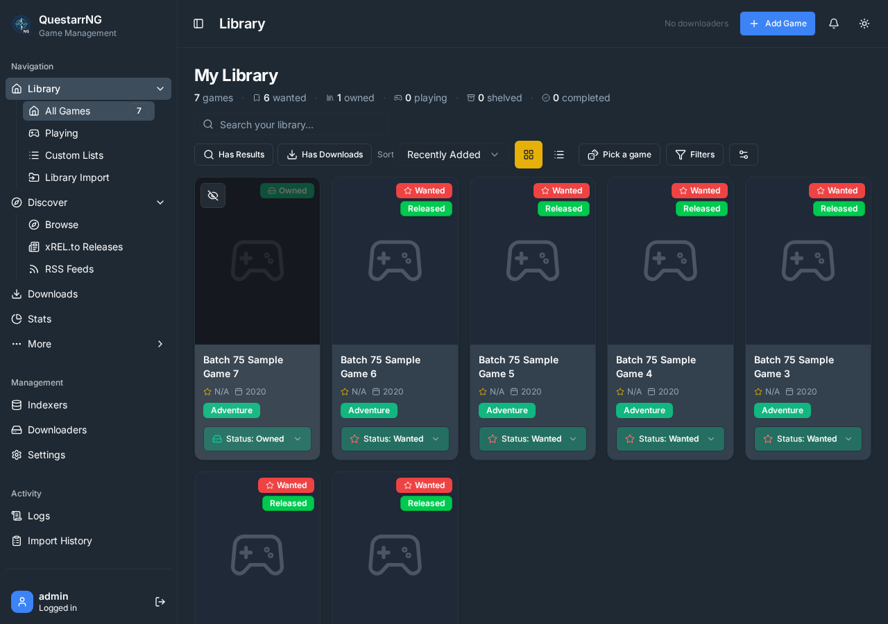
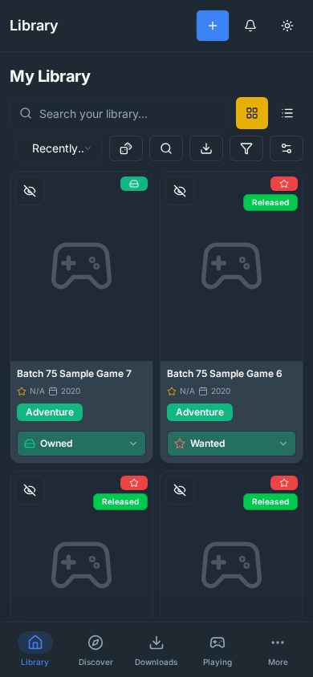
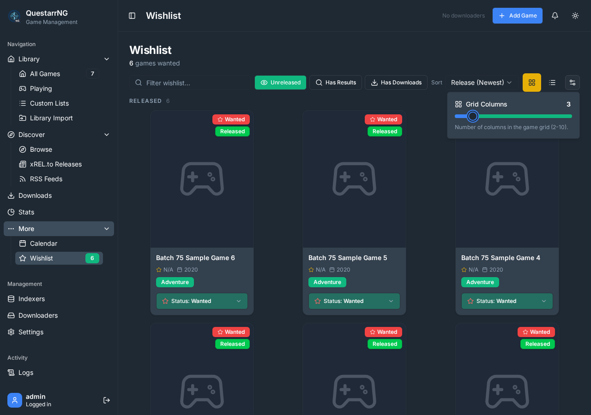
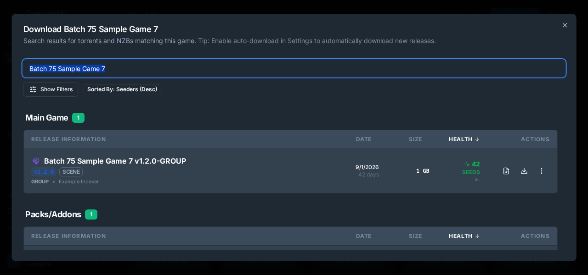
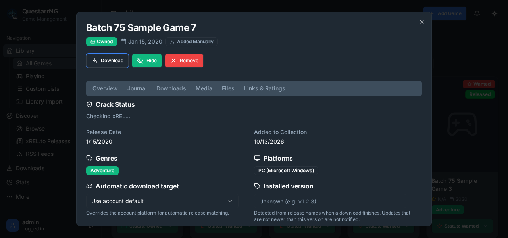

# Batch 75 validation: upstream issue #868 and PRs #867, #869–876

Batch 75 reviewed ten upstream records against the complete issue and pull
request descriptions, discussion, review threads, changed files, and checks.
All ten source digests matched the captured upstream snapshot at
`0b538fe4b0a2269edcc8fd3e71e2bbc240291868`. Their implementation and
verification evidence is recorded in the
[campaign ledger](../ledger.json) and
[campaign overview](../README.md).

## Changes and evidence

- The qBittorrent adapter now stops after its first failed pending-add status
  lookup. The accepted torrent stays discoverable by its correlation tag, while
  an unavailable or slow status endpoint cannot trigger repeated long requests.
  Regression coverage verifies one lookup, no premature download or upload,
  and no duplicate add attempt.
- Auto-search filtering and deduplication now share one helper for main,
  update, and Packs/Addons searches. Update searches still apply the installed
  version predicate before deduplication. Tests cover packs filtering by
  platform, OS architecture, preferred group, and duplicate candidates.
- Wishlist column tests cover the default, persistence, clamping, rounding,
  and invalid stored values. The remaining verified PR behavior is covered by
  existing implementation and tests for card actions, safe indexer links,
  hardlink fallback, initial release-state normalization, scrollbars, and the
  Packs/Addons category.

No `client/src/**` source file changed in this batch. A separate isolated
checkout ran `npm run dev:test`; its setup spec passed, the browser capture had
no page errors, and the screenshots below show the existing UI behavior being
reviewed:

## Test results

- Focused regression and UI behavior tests: **253 passed, 1 skipped** across
  nine test files.
- Full test suite: **4,274 passed, 7 skipped** across 274 test files.
- `npm run check`, `npm run lint`, `npm run format:check`,
  `npm run secretlint`, `npm run check:overrides`, and
  `npm run release-notes:check`: passed.
- Production Vite build and production TypeScript compilation to the
  task-scoped temporary output directory: passed. Vite printed its existing
  large-chunk advisory; the build had no errors.
- `git diff --check`: passed for the implementation changes.

Build output and the isolated browser-test worktree were stored in unique
task-scoped temporary directories and removed after validation. The six
review screenshots in `batch-75/` are retained as campaign evidence. No NFS
scratch space was used. Batch 75 implementation is commit
`10eee2966effae81cb03a2db8344bd1de63f9082`.
